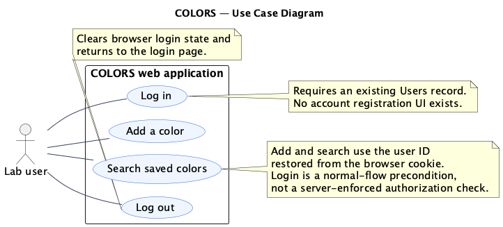
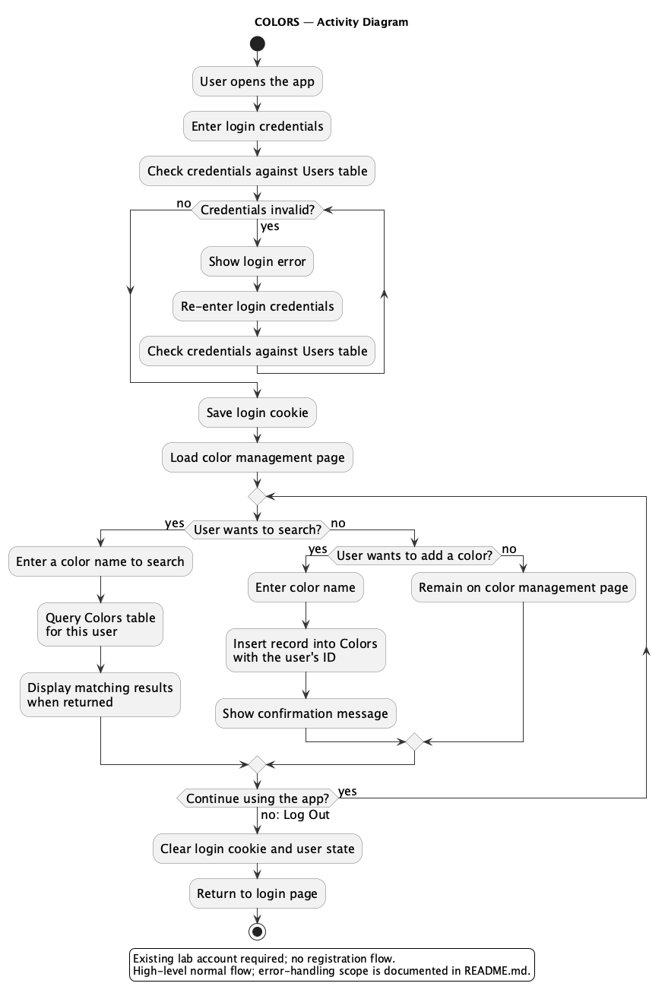
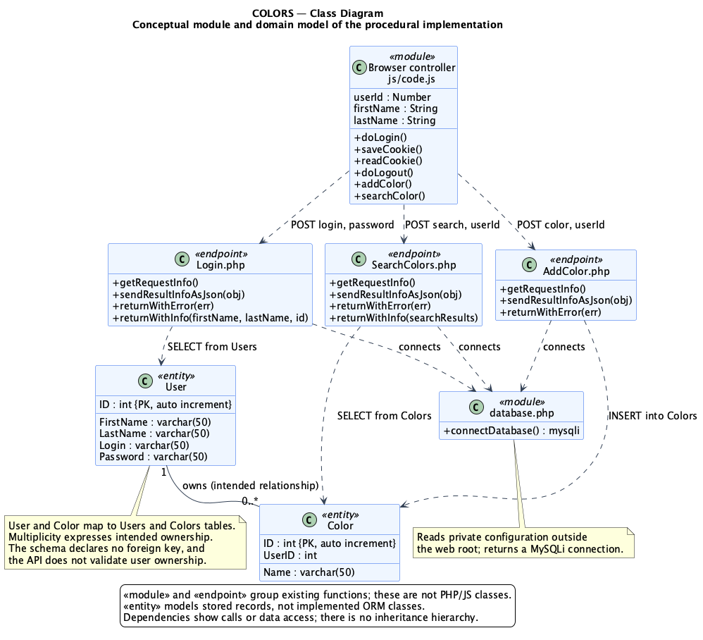

# COLORS UML diagrams

These diagrams model the existing application at commit `7ff224c`, using `js/code.js`, `LAMPAPI/*.php`, the HTML pages, and `database/schema.sql` as the implementation reference. No application behavior was changed for this assignment.

| Diagram | Editable source | Rendered diagram |
| --- | --- | --- |
| Use Case | [usecase.puml](usecase.puml) | [usecase.png](usecase.png) |
| Activity | [activity.puml](activity.puml) | [activity.png](activity.png) |
| Class | [class.puml](class.puml) | [class.png](class.png) |

## Use Case Diagram

The lab user can log in, add a color, search saved colors, and log out. An account already exists in the database. Login is a precondition of the normal UI workflow, not an included action repeated on every add/search request.



## Activity Diagram

The activity presents a simplified user workflow: login with retry after invalid credentials, save the login cookie, search or add colors, repeat, and log out. It assumes an existing account and normal database/HTTP operation. The application has no registration flow, separate color-value field, or explicit input-validation step.

To keep the diagram readable, it omits cookie-restoration failures, transport/SQL errors, and the empty-search failure path. “Display matching results when returned” covers successful searches only: when no records match, the API omits `results` and the current frontend callback fails while reading `results.length`. The add confirmation is displayed on HTTP 200 without inspecting the API error field. “Continue using the app?” is a user decision, not a literal dialog; its exit corresponds to clicking Log Out.



## Class Diagram

This is a conceptual class model of a procedural application. Stereotypes distinguish function modules and endpoints from domain entities; the repository does not implement these as PHP/JavaScript classes. The endpoint functions retain their actual source names. User and Color represent records in Users and Colors. A user is intended to own zero or more colors; the schema does not enforce that relationship with a foreign key.



## Render again

The PNG files were generated with PlantUML 1.2025.2 and Java. From the repository root, with a downloaded PlantUML JAR:

```bash
java -Djava.awt.headless=true -jar /path/to/plantuml.jar -tpng -failfast2 docs/uml/*.puml
```

The use case and class sources select PlantUML's [Smetana layout engine](https://plantuml.com/smetana02), so a separate Graphviz installation is not required. Edit the `.puml` files and regenerate the PNGs together.

Notation reference: the assignment's [Introduction to UML slides](https://ppawar.github.io/Spring2019/CSE308-S19/Slides/PDF/Introduction%20to%20UML.pdf).

AI usage: OpenAI Codex assisted with reading the existing code, authoring the PlantUML sources, rendering and reviewing the images, and committing this documentation.
